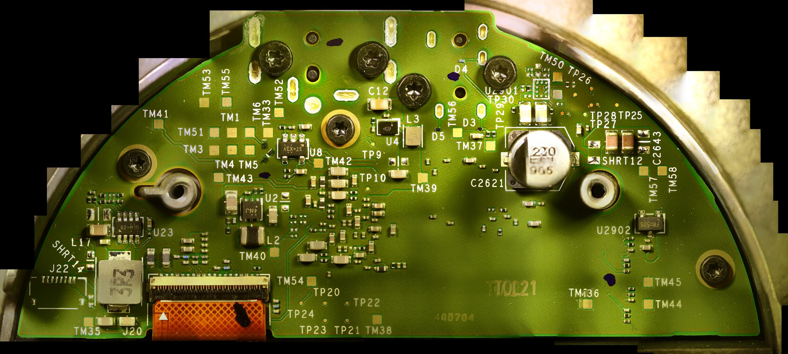
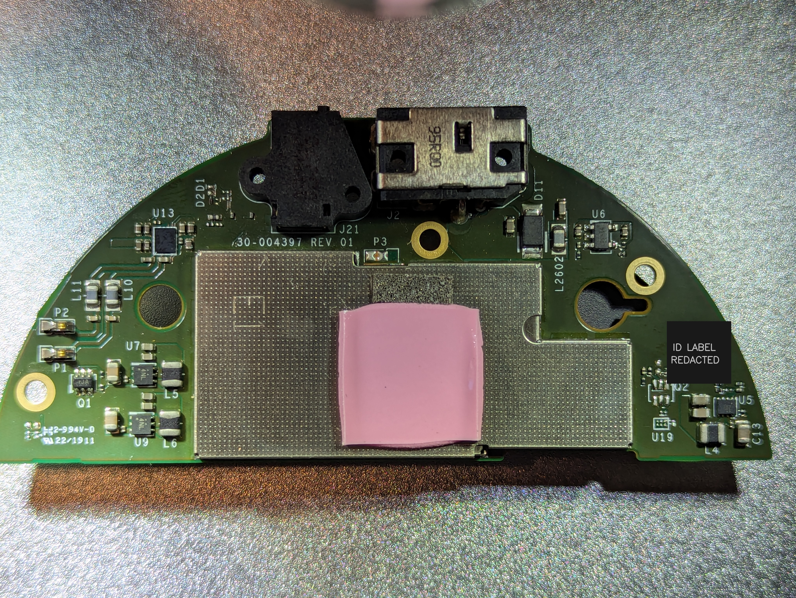
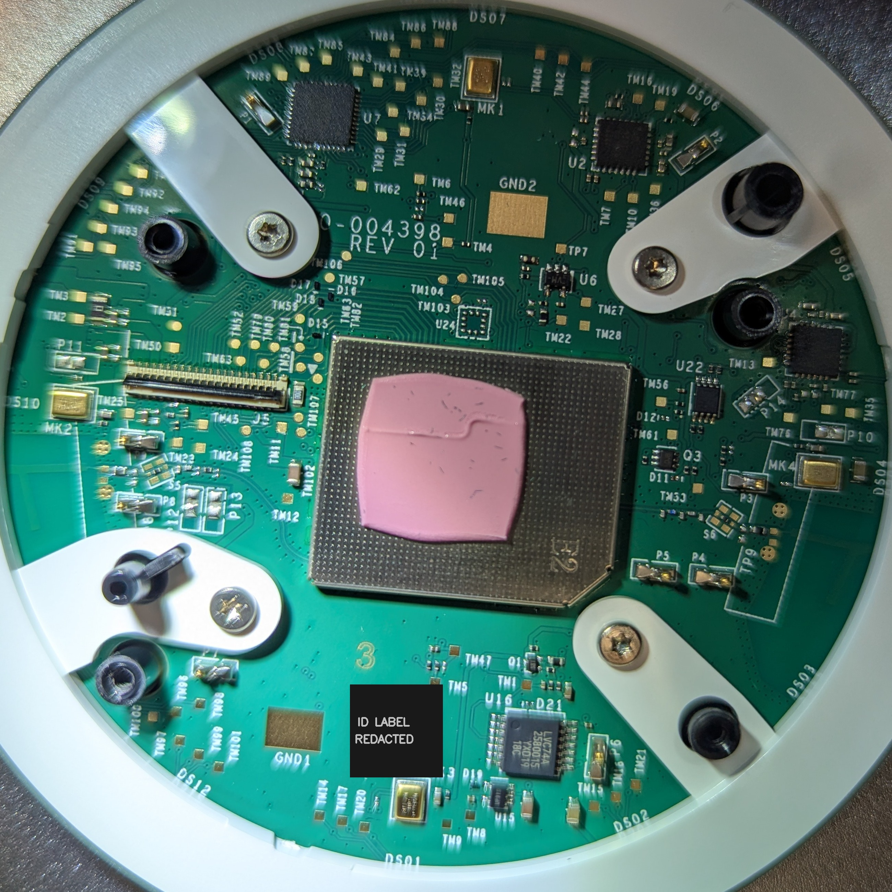

# Hardware facts and limits

**Crumpet** is the Echo Dot 3rd Gen Refresh (often model **C78MP8**). It uses **raw NAND** and should not be conflated with earlier **Donut**, which has different storage/boot behavior.

MTKClient reports hardware code `0x8167` on devices in [upstream issue #2](https://github.com/R0rt1z2/amonet-koboreru/issues/2). Some source projects label related MTK platform support `mt8516`; that naming by itself is not proof of a different chip.

A public 2019 [UART log](https://github.com/jvandewiel/no-alexa/blob/main/logicanalyzer/uart_logs/uart_normal_oldsw.txt) identifies NAND `MX30LF4G28AD`, bad-block handling, and a partition table containing `lk_a`, `lk_b`, `tee1`, `tee2`, `boot_a`, `boot_b`, `userdata`.

One caution: a 2026-10-22 boot log from a unit running the `20231103_072325` preloader reports a *different* NAND, a Toshiba TC58NVG2S0HTA00 (ID `98 DC 90 26 76 16`) with the same 4096+256 page geometry. So not every Crumpet necessarily has the Macronix part. Please check what your own unit reports, and see the [capture note](../research/uart-capture-2026-10-22.md).

These observations apply to the specifically logged hardware; other revisions must be checked independently.

## Board photos and silkscreen labels (2026-10-20)

**Observed.** I photographed one unit under a microscope camera (77 overlapping frames stitched into one image; the stitch is a map, not a measurement, and a few labels near tall parts are slightly smeared). Only the stitched and ID-label-masked images are published, not the individual frames.

The same half-disc board, on the side with the metal shield and connectors (ID label masked):

The round board (ID label masked):

- Model: C78MP8
- Boards: half-disc `30-004397 REV 01`, round `…-004398 REV 01`
- NAND: Toshiba TC58NVG2S0HTA00, ID `98 DC 90 26 76 16`, as reported over UART at boot. The chip marking itself was not photographed.

Silkscreen labels legible in the stitched image (**observed**, text only; nothing here is traced or electrically verified):

- Pads: TM1, TM3 to TM6, TM33, TM35 to TM45, TM50 to TM58
- Test points: TP9, TP10, TP20 to TP30
- Parts: U2, U4, U8, U23, U2901, U2902, L2, L3, L17, C12, D3 to D5, J20, J22, plus a flex connector

This unit has at least two boards. The labels above are from the half-disc board (marking `30-004397 REV 01`). TM59 does **not** appear on that board, but it is silkscreened on the separate round board (marking `…-004398 REV 01`), together with TM45, TM3, TM5 and TM6. Pad numbers repeat across the two boards (TM3 to TM6 appear on both), so always state which board a pad is on.

**UART, observed on this unit (2026-10-22).** With a USB-serial adapter set to 1.8 V logic, its RX wired to pad **TM45** on the pad side of the half-disc board (`30-004397 REV 01`), and its GND wired to the gold ring pad under one of the board's mounting screws (a ground connection), the unit printed its boot log on power-up. BootROM lines appear at 115200 baud and the preloader onward at 921600 (8N1). TM45 idles at about 1.825 V.

- TM44 read 2.044 V on an earlier check and 1.819 V when measured again 3 to 5 minutes after boot (see the table below). Attempts on TM44 at 3.3 V (115200 baud) and then at 1.8 V (115200 and 921600 baud) captured no readable output, only a few stray zero bytes. The 921600 attempt was logged across a power cycle; whether the 115200 attempt was is not recorded. TM44 was not seen transmitting on this unit.
- The adapter's TX was never connected, so whether either pad accepts input is untested.
- Pad numbers repeat across the two boards, so this applies to TM45 on the half-disc board only.

Other sources differ: the no-alexa wiki "Interfacing" page (third-party reported, edited 2021-09-29, device revision not stated) lists UART0 on "TM44/TM45" on the main logic board, with TM44 as TX and TM45 as RX, and USB on TM4/TM5. On this unit TM45 is the pad that transmits. An unattributed summary gave TX at TM59 (TM45 on some revisions), GND at TM3 and 1.8 V at TM5/TM6; no source for that was found. This unit agrees with it on TM45 and 1.8 V, and TM3 is continuous with the ground pad when the unit is off (table below).

### Multimeter readings on the pad side of the half-disc board (2026-10-22)

**Observed**, not traced: nothing here establishes what any pad does. Meter: Mestek CM81 (true RMS), needle probes. Powered readings: unit idle, 3 to 5 minutes after boot, measured against the gold ring pad under a mounting screw. Off readings: supply unplugged. A dash means not recorded.

| Pad | Powered (V) | Continuous with GND, off | Off: resistance to GND and notes |
|---|---|---|---|
| TM1 | 0 | yes | 0 Ω |
| TM3 | 0 | yes | - |
| TM4 | 1.0 | - | - |
| TM5 | 1.1 to 1.2, bouncing | - | - |
| TM6 | 1.821 | - | - |
| TM33 | 0 | yes | - |
| TM35 | 3.845 to 3.850, drifting slowly | - | - |
| TM36 | 1.357 | - | - |
| TM37 | 1.82 | no | - |
| TM38 | 3.34 | - | - |
| TM39 | 1.2 | - | - |
| TM40 | 1.143 | - | - |
| TM41 | 2.206 | - | - |
| TM42 | 2.831 | - | - |
| TM43 | 1.822 | - | - |
| TM44 | 1.819 | - | 13.8 kΩ, steady |
| TM45 | 1.825 | - | 13.7 kΩ, steady |
| TM50 | 0.00 | no | about 1.0 kΩ, steady |
| TM51 | 12.22 | - | 0 Ω to TM52 |
| TM52 | 12.25 | no | 0 Ω to TM51 |
| TM53 | 0.21 | yes | 0 Ω |
| TM54 | 1.823 | - | - |
| TM55 | 0.21 | - | - |
| TM56 | 1.778 | - | - |
| TM57 | 0 | no | not stable: began near 15 kΩ and rose past 30 kΩ over about 5 s; later about 100 kΩ and falling |
| TM58 | 0 | no | not stable: same rising behaviour as TM57 |

- TM51 and TM52 are the same net (0 Ω) at about 12 V, which fits the supply input. Treat both as hazardous.
- TM53 and TM55 read 0.21 V while TM53 is 0 Ω to ground when off. I don't know why.
- Resistance that drifts while being measured (TM57, TM58) is typical of measuring across capacitance, so no single value is given.
- The meter itself applies a small voltage when measuring ohms, and pad readings can shift with probe contact.

As with the logs above, these observations apply to this unit only; other revisions must be checked independently.
